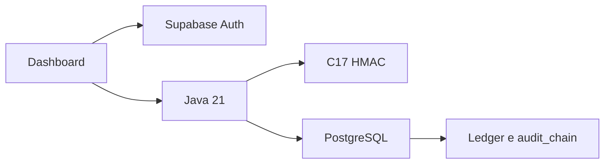

# ◇ ConfidenceWallet

Plataforma experimental de checkout e gestão de pedidos em **modo de teste**, com Supabase Auth/PostgreSQL, funções Node na Vercel para Mercado Pago Orders, core Java 21 e auditoria C17 para o ledger demonstrativo. **Não é um banco, não processa dinheiro real e não oferece custódia regulada.**

## Arquitetura

| Camada | Responsabilidade |
| --- | --- |
| Vercel (raiz e /api) | Auth, loja, painel e funções de teste para Mercado Pago Orders |
| Java 21 (backend) | JWT, antifraude, idempotência, JDBC, FX e orquestração |
| PostgreSQL Supabase | Partidas dobradas, saldos, trigger de imutabilidade, RLS e serialização |
| C17 (native-audit) | SHA-256/HMAC-SHA256, CLI e biblioteca via Project Panama |

O frontend não tem permissão de escrever em tabelas financeiras. O core verifica a cadeia inteira antes do débito, adquire advisory lock transacional, consulta o saldo e chama `private.execute_double_entry_transfer`. A função bloqueia as carteiras em ordem crescente do UUID, valida a chave de idempotência, debita e credita na mesma transação, grava duas entradas e anexa o hash encadeado. O HMAC usa uma chave de 32 bytes exclusiva do backend. O banco valida o hash canônico; a verificação do HMAC depende do core e da proteção operacional da chave. Um operador de banco com privilégios elevados continua podendo alterar dados; ancoragem externa, backup WORM e dupla aprovação são necessárias para uma garantia adversarial maior.

## Estrutura

`/` contém HTML/CSS/JS ES Modules e `vercel.json`; `api/` e `lib/` contêm as funções de checkout; `backend/` contém Maven e Dockerfile; `native-audit/` contém biblioteca/CLI; `supabase/migrations/` contém SQL aplicado; `.github/` contém CI, CodeQL e Dependabot.

## Implantação

1. O projeto Supabase `wabpybyaqiatelaecpal` já tem as migrations aplicadas. O cadastro por e-mail permite comprador ou candidato a vendedor; a conta `ceo@brunnodev.store` mantém `ADMIN`. O tipo informado pelo usuário não concede poderes financeiros. Configure confirmação de e-mail no Supabase Auth e SMTP; Google requer configuração OAuth independente. Nunca armazene senhas no repositório.
2. Gere a chave HMAC: `openssl rand -hex 32`. Guarde em `AUDIT_HMAC_KEY_HEX` no Azure Container Apps, não no Git. A rotação exige processo de reancoragem por época; não troque a chave sem migração.
3. Configure `DATABASE_URL` (JDBC com SSL), `DATABASE_USER`, `DATABASE_PASSWORD`, `SUPABASE_URL` e `ALLOWED_ORIGIN` no Container App. Use credenciais de banco exclusivas, com TLS e acesso restrito por rede. O código atual usa `postgres` para chamar a função privada; antes de produção, substitua por role de serviço com grants mínimos e revise a checagem de identidade na função.
4. `docker build -f backend/Dockerfile -t confidencewallet-core .` e publique a imagem no Azure Container Apps. Garanta `/health` e HTTPS. Defina a URL HTTPS da API em `config.js` e publique na Vercel, com raiz do projeto em `/`, framework Other e sem build.
5. Em desenvolvimento: `make -C native-audit test`, `mvn -f backend/pom.xml test package`. Java 21 requer `--enable-preview --enable-native-access=ALL-UNNAMED` para FFM. O Dockerfile já contém esses flags.

### Endpoints

`POST /api/transfer` recebe bearer token Supabase, cabeçalho `X-Idempotency-Key` UUID e JSON `{"source":"UUID","destination":"UUID","amount":"1.0000"}`. `GET /api/fx?from=BRL&to=USD` usa Frankfurter, cache de cinco minutos. `GET /api/audit` verifica a cadeia inteira e exige ADMIN. `GET /health` informa disponibilidade do processo, não a integridade do banco.

### Segurança e limites

- RLS em todas as tabelas novas; leitura somente por proprietário ou ADMIN. O papel é guardado em `profiles` e não em metadados editáveis pelo usuário. O painel consolidado exige ADMIN.
- Máximo de dez tentativas por minuto por usuário em memória. Em várias réplicas, um limitador compartilhado é necessário. Movimento acima de 3× a média histórica gera alerta; a regra, por si só, não bloqueia a transação. Não há sistema AML/KYC, chargeback, custódia, funding ou saques externos.
- A cadeia SHA-256 é linear e autenticada por HMAC; não é árvore de Merkle. A assinatura da linha é verificada pelo core antes da transferência; as regras de banco isoladas não possuem a chave para validar HMAC.
- O saldo é `numeric(24,4)`. A API exige até quatro casas; câmbio exibido usa `HALF_EVEN`, mas não realiza conversão contábil.
- OAuth depende das credenciais e habilitação dos provedores no painel Supabase. Realtime está publicado para contas e transações; a leitura inicial também funciona sem canal ativo.
- Antes de operar em produção: testes de concorrência com banco real, gestão de segredos, auditoria independente, limites globais, segregação de funções e procedimentos de reconciliação externa.

## Referências de controles

Os princípios de trilha auditável, transparência proporcional e controle interno têm como referência [Nonato, ENAP (2018)](https://repositorio.enap.gov.br/bitstreams/7e4dc3af-08d5-4b14-8b1d-47287c61c1ae/download). Os demais repositórios acadêmicos indicados no escopo não permitiram leitura integral nesta implementação; os controles foram tratados como requisitos de engenharia, sem atribuir conclusões específicas a textos não verificados.

Licença MIT em [LICENSE](LICENSE).

## Recuperação de acesso

O usuário ADMIN existente pode recuperar a senha pelo botão **Recuperar senha** quando o SMTP do Supabase estiver funcional. O formulário de destino usa `PASSWORD_RECOVERY` e `updateUser`. Um erro SMTP `535 Authentication failed` indica credenciais inválidas no provedor de e-mail; corrija-as no painel Auth > SMTP. O segredo nunca é salvo no repositório. Não exclua o usuário para trocar a senha: isso quebraria os vínculos com as carteiras.

O painel **Conta administradora → Alterar senha** chama `auth.updateUser` na sessão autenticada. Após a troca, a sessão é encerrada para que o novo login seja testado.

## Gateway Mercado Pago Orders — teste

O catálogo público está em `/checkout.html`. Compradores e candidatos a vendedores podem criar conta via Supabase Auth; o vendedor começa em `PENDING` e não publica nem recebe pagamentos sem verificação e conexão própria com o Mercado Pago. O ADMIN opera o piloto de **uma conta vendedora de teste**. A loja extrai preço do banco; o servidor cria uma `/v1/orders` com UUID de idempotência e redireciona ao `checkout_url`. O retorno ao site não confirma pagamento. O webhook de teste verifica HMAC, consulta a order com Access Token de teste, compara ID/referência, BRL e valor, e só então registra `approved` quando `processed/accredited` e o valor pago bate. A função SQL é executável apenas por `service_role`. Eventos duplicados não geram crédito.

### Configuração de teste

1. Em Mercado Pago Developers → ConfidenceWallet → **Teste**, copie o **Access Token de teste** para a variável Vercel `MP_TEST_ACCESS_TOKEN`. Configure o webhook de **Teste** em `https://confidencewallet.vercel.app/api/payment-webhook`, evento **Order (Mercado Pago)**, e salve a assinatura secreta em `MP_TEST_WEBHOOK_SECRET`.
2. Em Vercel → ConfidenceWallet → Settings → Environment Variables, adicione em **Production** (o site público usa o modo de teste): `MP_TEST_ACCESS_TOKEN`, `MP_TEST_WEBHOOK_SECRET`, `SUPABASE_SERVICE_ROLE_KEY` como segredos e `MP_TEST_SELLER_ID` como UUID do perfil ADMIN no Supabase. Reimplante após salvar. Nunca coloque tokens no frontend, `config.js`, Git ou chat. Não configure token de produção nesta fase.
3. Crie um produto como ADMIN. Faça uma compra usando **conta e cartão de teste** do Mercado Pago; confira pedido, webhook e repetição de notificação. Um comprador comum não precisa de conta ConfidenceWallet para o checkout piloto. O dinheiro não é creditado às carteiras BRL/USD/EUR.
4. Antes de aceitar vendedores terceiros, implemente OAuth e reconciliação por vendedor, split/payouts conforme o produto contratado, KYC/AML e política comercial. Não use a credencial do ADMIN para cobrar em nome de outro vendedor.

`npm test` cobre assinatura de Orders e centavos exatos. Sem os quatro valores de configuração, `POST /api/checkout` responde 503 e nenhuma order é criada. A migration `20261127093000_orders_test_and_signup.sql` abre o cadastro e prepara a Orders API; `20261127090000_gateway_checkout.sql` contém as tabelas iniciais com RLS.

