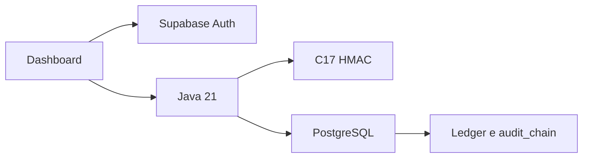

# ◇ ConfidenceWallet

Carteira experimental com frontend estático, core Java 21 e auditoria C17. **Não é um banco, não processa moeda fiduciária real e não oferece custódia regulada.** Saldos começam em zero; entradas de recursos exigem uma integração de liquidação externa, que não está implementada.

## Arquitetura

| Camada | Responsabilidade |
| --- | --- |
| Vercel (raiz) | Auth, dashboard e leitura sob RLS; chama a API para transferências |
| Java 21 (backend) | JWT, antifraude, idempotência, JDBC, FX e orquestração |
| PostgreSQL Supabase | Partidas dobradas, saldos, trigger de imutabilidade, RLS e serialização |
| C17 (native-audit) | SHA-256/HMAC-SHA256, CLI e biblioteca via Project Panama |

O frontend não tem permissão de escrever em tabelas financeiras. O core verifica a cadeia inteira antes do débito, adquire advisory lock transacional, consulta o saldo e chama `private.execute_double_entry_transfer`. A função bloqueia as carteiras em ordem crescente do UUID, valida a chave de idempotência, debita e credita na mesma transação, grava duas entradas e anexa o hash encadeado. O HMAC usa uma chave de 32 bytes exclusiva do backend. O banco valida o hash canônico; a verificação do HMAC depende do core e da proteção operacional da chave. Um operador de banco com privilégios elevados continua podendo alterar dados; ancoragem externa, backup WORM e dupla aprovação são necessárias para uma garantia adversarial maior.

## Estrutura

`/` contém HTML/CSS/JS ES Modules e `vercel.json`; `backend/` contém Maven e Dockerfile; `native-audit/` contém biblioteca/CLI; `supabase/migrations/` contém SQL aplicado; `.github/` contém CI, CodeQL e Dependabot.

## Implantação

1. Configure o projeto Supabase `wabpybyaqiatelaecpal`. As migrations `confidencewallet_core`, `confidencewallet_indexes_realtime` e `confidence_admin_only_signup` já foram aplicadas; para um projeto novo aplique os arquivos em `supabase/migrations/` na ordem, criando a conta administradora antes do bloqueio de cadastro. Ative Google com Client ID e Client Secret no Auth e configure a URL de redirecionamento. A interface consulta a disponibilidade do provedor antes de habilitar o botão. A migration `confidence_admin_only_signup` fecha novos cadastros no projeto atual. A conta `ceo@brunnodev.store` é a única conta Auth permitida e tem perfil `ADMIN`; nenhuma senha ou hash de senha é armazenado no repositório. Em outro projeto, faça o bootstrap controlado do administrador antes de aplicar esse bloqueio.
2. Gere a chave HMAC: `openssl rand -hex 32`. Guarde em `AUDIT_HMAC_KEY_HEX` no Azure Container Apps, não no Git. A rotação exige processo de reancoragem por época; não troque a chave sem migração.
3. Configure `DATABASE_URL` (JDBC com SSL), `DATABASE_USER`, `DATABASE_PASSWORD`, `SUPABASE_URL` e `ALLOWED_ORIGIN` no Container App. Use credenciais de banco exclusivas, com TLS e acesso restrito por rede. O código atual usa `postgres` para chamar a função privada; antes de produção, substitua por role de serviço com grants mínimos e revise a checagem de identidade na função.
4. `docker build -f backend/Dockerfile -t confidencewallet-core .` e publique a imagem no Azure Container Apps. Garanta `/health` e HTTPS. Defina a URL HTTPS da API em `config.js` e publique na Vercel, com raiz do projeto em `/`, framework Other e sem build.
5. Em desenvolvimento: `make -C native-audit test`, `mvn -f backend/pom.xml test package`. Java 21 requer `--enable-preview --enable-native-access=ALL-UNNAMED` para FFM. O Dockerfile já contém esses flags.

### Endpoints

`POST /api/transfer` recebe bearer token Supabase, cabeçalho `X-Idempotency-Key` UUID e JSON `{"source":"UUID","destination":"UUID","amount":"1.0000"}`. `GET /api/fx?from=BRL&to=USD` usa Frankfurter, cache de cinco minutos. `GET /api/audit` verifica a cadeia inteira e exige ADMIN. `GET /health` informa disponibilidade do processo, não a integridade do banco.

### Segurança e limites

- RLS em todas as tabelas novas; leitura somente por proprietário ou ADMIN. O papel é guardado em `profiles` e não em metadados editáveis pelo usuário. O painel consolidado exige ADMIN.
- Máximo de dez tentativas por minuto por usuário em memória. Em várias réplicas, um limitador compartilhado é necessário. Movimento acima de 3× a média histórica gera alerta; a regra, por si só, não bloqueia a transação. Não há sistema AML/KYC, chargeback, custódia, funding ou saques externos.
- A cadeia SHA-256 é linear e autenticada por HMAC; não é árvore de Merkle. A assinatura da linha é verificada pelo core antes da transferência; as regras de banco isoladas não possuem a chave para validar HMAC.
- O saldo é `numeric(24,4)`. A API exige até quatro casas; câmbio exibido usa `HALF_EVEN`, mas não realiza conversão contábil.
- OAuth depende das credenciais e habilitação dos provedores no painel Supabase. Realtime está publicado para contas e transações; a leitura inicial também funciona sem canal ativo.
- Antes de operar em produção: testes de concorrência com banco real, gestão de segredos, auditoria independente, limites globais, segregação de funções e procedimentos de reconciliação externa.

## Referências de controles

Os princípios de trilha auditável, transparência proporcional e controle interno têm como referência [Nonato, ENAP (2018)](https://repositorio.enap.gov.br/bitstreams/7e4dc3af-08d5-4b14-8b1d-47287c61c1ae/download). Os demais repositórios acadêmicos indicados no escopo não permitiram leitura integral nesta implementação; os controles foram tratados como requisitos de engenharia, sem atribuir conclusões específicas a textos não verificados.

Licença MIT em [LICENSE](LICENSE).

## Recuperação de acesso

O usuário ADMIN existente pode recuperar a senha pelo botão **Recuperar senha** quando o SMTP do Supabase estiver funcional. O formulário de destino usa `PASSWORD_RECOVERY` e `updateUser`. Um erro SMTP `535 Authentication failed` indica credenciais inválidas no provedor de e-mail; corrija-as no painel Auth > SMTP. O segredo nunca é salvo no repositório. Não exclua o usuário para trocar a senha: isso quebraria os vínculos com as carteiras.

O painel **Conta administradora → Alterar senha** chama `auth.updateUser` na sessão autenticada. Após a troca, a sessão é encerrada para que o novo login seja testado.

## Gateway de checkout Mercado Pago

O catálogo público está em `/checkout.html`. O ADMIN publica produtos BRL no painel; o servidor cria um pedido com preço obtido do banco e uma preferência Checkout Pro. O comprador paga no ambiente do Mercado Pago. O retorno do navegador apenas exibe o status; **somente webhook assinado, consulta autenticada à API do Mercado Pago e comparação de pedido/valor/moeda** podem alterar o estado. Eventos duplicados são idempotentes. O dinheiro liquida na conta Mercado Pago do titular, não nas carteiras do dashboard. A interface não recebe dados de cartão.

As funções Node da Vercel em `/api` orquestram o checkout e as notificações; o core Java 21 continua separado para o ledger, ainda sem implantação. A nova migration `supabase/migrations/20261127090000_gateway_checkout.sql` cria `products`, `checkout_orders` e `payment_events` com RLS. A função de confirmação é executável apenas por `service_role`.

### Ativação

1. Crie a aplicação Checkout Pro em [Suas integrações do Mercado Pago](https://www.mercadopago.com.br/developers/panel/app), obtenha o **Access Token de produção** e habilite os meios de pagamento disponíveis para sua conta.
2. Em Vercel → ConfidenceWallet → Settings → Environment Variables, configure os segredos **encrypted/sensitive** para Production: `MP_ACCESS_TOKEN`, `MP_WEBHOOK_SECRET` e `SUPABASE_SERVICE_ROLE_KEY` (chave `service_role`/secret do projeto Supabase). Nunca use prefixo `NEXT_PUBLIC_`, `VITE_`, arquivo `config.js` ou commit para esses valores. Reimplante após salvar.
3. Em Mercado Pago → aplicação → Webhooks, configure URL de produção `https://confidencewallet.vercel.app/api/payment-webhook`, evento **Pagamentos**, e copie a chave secreta de assinatura para `MP_WEBHOOK_SECRET`.
4. Publique um produto no painel ADMIN, teste uma compra real de baixo valor e confirme pedido `approved` só após webhook. Verifique também estorno e notificação duplicada. Faça conciliação diária com relatórios do Mercado Pago antes de liberar vendas em escala.

`npm test` verifica assinatura HMAC e valores em centavos. Enquanto os três segredos não estiverem presentes, o endpoint retorna HTTP 503 e não cria cobranças. Não exiba os valores em logs nem envie credenciais em chat. Para operação com vários vendedores, split/payouts, afiliados, saldos resgatáveis e transferências externas, é necessário onboarding dos recebedores, contratos e controles regulatórios adicionais; esta etapa atende **uma única conta vendedora**. As carteiras BRL/USD/EUR legadas permanecem demonstrativas e não recebem crédito automático de pedidos.
