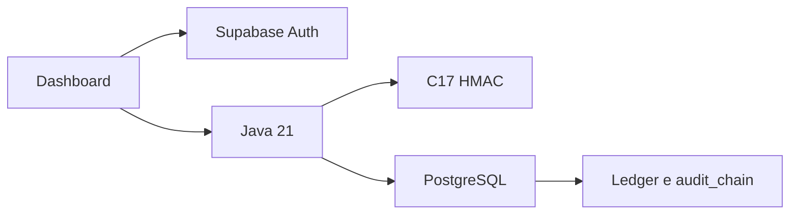

# ◇ ConfidenceWallet

Carteira experimental com frontend estático, core Java 21 e auditoria C17. **Não é um banco, não processa moeda fiduciária real e não oferece custódia regulada.** Saldos começam em zero; entradas de recursos exigem uma integração de liquidação externa, que não está implementada.

## Arquitetura

| Camada | Responsabilidade |
| --- | --- |
| Vercel (raiz) | Auth, dashboard e leitura sob RLS; chama a API para transferências |
| Java 21 (backend) | JWT, antifraude, idempotência, JDBC, FX e orquestração |
| PostgreSQL Supabase | Partidas dobradas, saldos, trigger de imutabilidade, RLS e serialização |
| C17 (native-audit) | SHA-256/HMAC-SHA256, CLI e biblioteca via Project Panama |

O frontend não tem permissão de escrever em tabelas financeiras. O core verifica a cadeia inteira antes do débito, adquire advisory lock transacional, consulta o saldo e chama `private.execute_double_entry_transfer`. A função bloqueia as carteiras em ordem crescente do UUID, valida a chave de idempotência, debita e credita na mesma transação, grava duas entradas e anexa o hash encadeado. O HMAC usa uma chave de 32 bytes exclusiva do backend. O banco valida o hash canônico; a verificação do HMAC depende do core e da proteção operacional da chave. Um operador de banco com privilégios elevados continua podendo alterar dados; ancoragem externa, backup WORM e dupla aprovação são necessárias para uma garantia adversarial maior.

## Estrutura

`/` contém HTML/CSS/JS ES Modules e `vercel.json`; `backend/` contém Maven e Dockerfile; `native-audit/` contém biblioteca/CLI; `supabase/migrations/` contém SQL aplicado; `.github/` contém CI, CodeQL e Dependabot.

## Implantação

1. Configure o projeto Supabase `wabpybyaqiatelaecpal`. As migrations `confidencewallet_core` e `confidencewallet_indexes_realtime` já foram aplicadas; para um projeto novo aplique os dois arquivos em `supabase/migrations/` na ordem. Ative os provedores OAuth e URLs de redirecionamento no Auth. O primeiro cadastro ganha ADMIN de forma atômica; efetue esse cadastro em ambiente controlado **antes de abrir inscrições públicas**. O e-mail não é um fator confiável para atribuição automática de privilégio. Nenhuma senha de administrador é armazenada no repositório.
2. Gere a chave HMAC: `openssl rand -hex 32`. Guarde em `AUDIT_HMAC_KEY_HEX` no Azure Container Apps, não no Git. A rotação exige processo de reancoragem por época; não troque a chave sem migração.
3. Configure `DATABASE_URL` (JDBC com SSL), `DATABASE_USER`, `DATABASE_PASSWORD`, `SUPABASE_URL` e `ALLOWED_ORIGIN` no Container App. Use credenciais de banco exclusivas, com TLS e acesso restrito por rede. O código atual usa `postgres` para chamar a função privada; antes de produção, substitua por role de serviço com grants mínimos e revise a checagem de identidade na função.
4. `docker build -f backend/Dockerfile -t confidencewallet-core .` e publique a imagem no Azure Container Apps. Garanta `/health` e HTTPS. Defina a URL HTTPS da API em `config.js` e publique na Vercel, com raiz do projeto em `/`, framework Other e sem build.
5. Em desenvolvimento: `make -C native-audit test`, `mvn -f backend/pom.xml test package`. Java 21 requer `--enable-preview --enable-native-access=ALL-UNNAMED` para FFM. O Dockerfile já contém esses flags.

### Endpoints

`POST /api/transfer` recebe bearer token Supabase, cabeçalho `X-Idempotency-Key` UUID e JSON `{"source":"UUID","destination":"UUID","amount":"1.0000"}`. `GET /api/fx?from=BRL&to=USD` usa Frankfurter, cache de cinco minutos. `GET /api/audit` verifica a cadeia inteira e exige ADMIN. `GET /health` informa disponibilidade do processo, não a integridade do banco.

### Segurança e limites

- RLS em todas as tabelas novas; leitura somente por proprietário ou ADMIN. O papel é guardado em `profiles` e não em metadados editáveis pelo usuário. O painel consolidado exige ADMIN.
- Máximo de dez tentativas por minuto por usuário em memória. Em várias réplicas, um limitador compartilhado é necessário. Movimento acima de 3× a média histórica gera alerta; a regra, por si só, não bloqueia a transação. Não há sistema AML/KYC, chargeback, custódia, funding ou saques externos.
- A cadeia SHA-256 é linear e autenticada por HMAC; não é árvore de Merkle. A assinatura da linha é verificada pelo core antes da transferência; as regras de banco isoladas não possuem a chave para validar HMAC.
- O saldo é `numeric(24,4)`. A API exige até quatro casas; câmbio exibido usa `HALF_EVEN`, mas não realiza conversão contábil.
- OAuth depende das credenciais e habilitação dos provedores no painel Supabase. Realtime está publicado para contas e transações; a leitura inicial também funciona sem canal ativo.
- Antes de operar em produção: testes de concorrência com banco real, gestão de segredos, auditoria independente, limites globais, segregação de funções e procedimentos de reconciliação externa.

## Referências de controles

Os princípios de trilha auditável, transparência proporcional e controle interno têm como referência [Nonato, ENAP (2018)](https://repositorio.enap.gov.br/bitstreams/7e4dc3af-08d5-4b14-8b1d-47287c61c1ae/download). Os demais repositórios acadêmicos indicados no escopo não permitiram leitura integral nesta implementação; os controles foram tratados como requisitos de engenharia, sem atribuir conclusões específicas a textos não verificados.

Licença MIT em [LICENSE](LICENSE).
